<a href="https://haashirkhan.com"><picture><source media="(prefers-color-scheme: dark)" srcset="assets/header-dark.svg"><source media="(prefers-color-scheme: light)" srcset="assets/header-light.svg"></picture></a>

<picture><source media="(prefers-color-scheme: dark)" srcset="assets/typing-dark.svg"><source media="(prefers-color-scheme: light)" srcset="assets/typing-light.svg"></picture>

<picture><source media="(prefers-color-scheme: dark)" srcset="assets/current-orbit-dark.svg"><source media="(prefers-color-scheme: light)" srcset="assets/current-orbit-light.svg">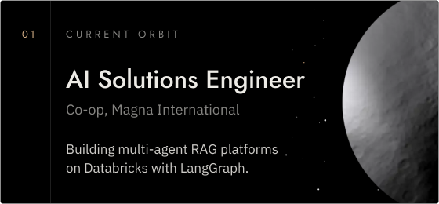</picture>

<picture><source media="(prefers-color-scheme: dark)" srcset="assets/mission-log-dark.svg"><source media="(prefers-color-scheme: light)" srcset="assets/mission-log-light.svg"></picture>

<picture><source media="(prefers-color-scheme: dark)" srcset="assets/launched-dark.svg"><source media="(prefers-color-scheme: light)" srcset="assets/launched-light.svg"></picture> 
<a href="https://github.com/CSC392-CSC492-Building-AI-ML-systems/AutoDocs-Winter2026"><picture><source media="(prefers-color-scheme: dark)" srcset="assets/project-autodocs-dark.svg"><source media="(prefers-color-scheme: light)" srcset="assets/project-autodocs-light.svg">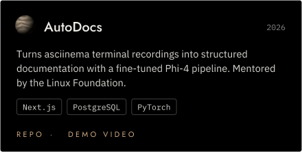</picture></a> 
<a href="https://github.com/ShishirAravindan/nfl-prediction-MoE"><picture><source media="(prefers-color-scheme: dark)" srcset="assets/project-nfl-moe-dark.svg"><source media="(prefers-color-scheme: light)" srcset="assets/project-nfl-moe-light.svg">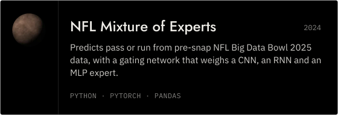</picture></a> 
<a href="https://github.com/gdgutm/PlogGo"><picture><source media="(prefers-color-scheme: dark)" srcset="assets/project-ploggo-dark.svg"><source media="(prefers-color-scheme: light)" srcset="assets/project-ploggo-light.svg">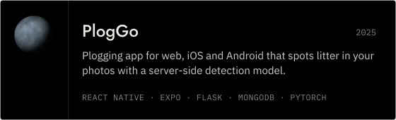</picture></a> 
<a href="https://github.com/AviGhat/deerhacks2025"><picture><source media="(prefers-color-scheme: dark)" srcset="assets/project-discover-me-dark.svg"><source media="(prefers-color-scheme: light)" srcset="assets/project-discover-me-light.svg">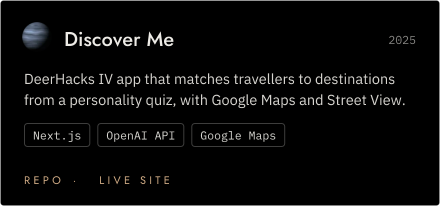</picture></a> 
<a href="https://github.com/haashirk20/texchange"><picture><source media="(prefers-color-scheme: dark)" srcset="assets/project-texchange-dark.svg"><source media="(prefers-color-scheme: light)" srcset="assets/project-texchange-light.svg">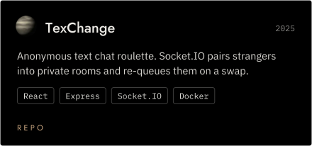</picture></a>

Each card opens its repository. Demos: <a href="https://drive.google.com/file/d/1ssCTLpFQCOF0IWctK1j3NYFi1jjNiI9B/view">AutoDocs demo video</a> · <a href="https://deerhacks2025.vercel.app/">Discover Me live site</a>.

<picture><source media="(prefers-color-scheme: dark)" srcset="assets/system-map-dark.svg"><source media="(prefers-color-scheme: light)" srcset="assets/system-map-light.svg">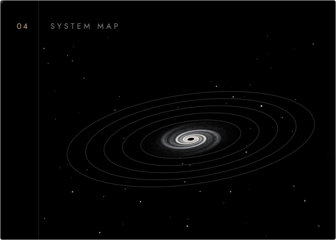</picture>

Orbits from the core outward: <a href="https://github.com/CSC392-CSC492-Building-AI-ML-systems/AutoDocs-Winter2026">AutoDocs</a> · <a href="https://github.com/ShishirAravindan/nfl-prediction-MoE">NFL Mixture of Experts</a> · <a href="https://github.com/gdgutm/PlogGo">PlogGo</a> · <a href="https://github.com/AviGhat/deerhacks2025">Discover Me</a> · <a href="https://github.com/haashirk20/texchange">TexChange</a>

<picture><source media="(prefers-color-scheme: dark)" srcset="assets/constellation-dark.svg"><source media="(prefers-color-scheme: light)" srcset="assets/constellation-light.svg"></picture>

<picture><source media="(prefers-color-scheme: dark)" srcset="https://raw.githubusercontent.com/haashirk20/haashirk20/output/telemetry-dark.svg"><source media="(prefers-color-scheme: light)" srcset="https://raw.githubusercontent.com/haashirk20/haashirk20/output/telemetry-light.svg">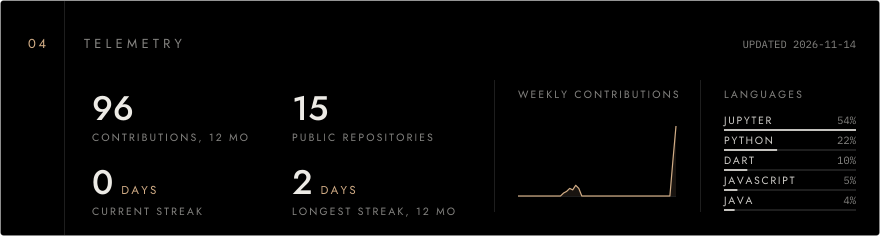</picture>

<picture><source media="(prefers-color-scheme: dark)" srcset="assets/activity-dark.svg"><source media="(prefers-color-scheme: light)" srcset="assets/activity-light.svg">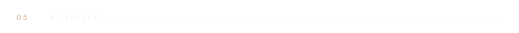</picture> 
<picture><source media="(prefers-color-scheme: dark)" srcset="https://raw.githubusercontent.com/haashirk20/haashirk20/output/snake-dark.svg"><source media="(prefers-color-scheme: light)" srcset="https://raw.githubusercontent.com/haashirk20/haashirk20/output/snake-light.svg"></picture>

<picture><source media="(prefers-color-scheme: dark)" srcset="assets/comms-dark.svg"><source media="(prefers-color-scheme: light)" srcset="assets/comms-light.svg"></picture> 
<a href="https://haashirkhan.com"><picture><source media="(prefers-color-scheme: dark)" srcset="assets/channel-1-dark.svg"><source media="(prefers-color-scheme: light)" srcset="assets/channel-1-light.svg">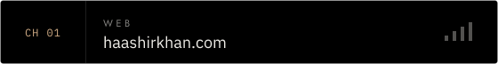</picture></a> 
<a href="https://www.linkedin.com/in/haashir-khan/"><picture><source media="(prefers-color-scheme: dark)" srcset="assets/channel-2-dark.svg"><source media="(prefers-color-scheme: light)" srcset="assets/channel-2-light.svg"></picture></a> 
<a href="mailto:haashirk2003@gmail.com"><picture><source media="(prefers-color-scheme: dark)" srcset="assets/channel-3-dark.svg"><source media="(prefers-color-scheme: light)" srcset="assets/channel-3-light.svg"></picture></a>

<picture><source media="(prefers-color-scheme: dark)" srcset="assets/footer-dark.svg"><source media="(prefers-color-scheme: light)" srcset="assets/footer-light.svg"></picture>

