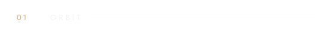
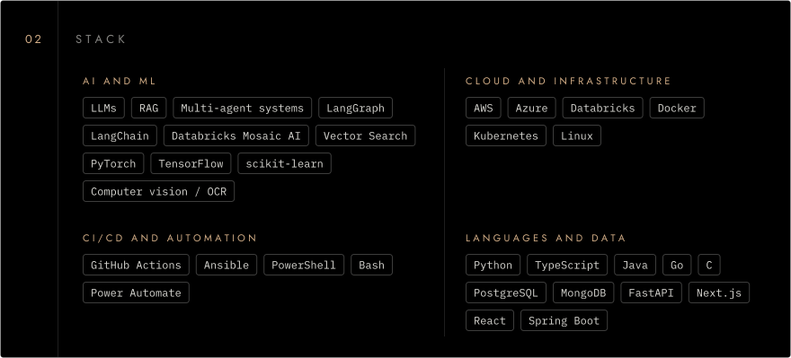
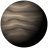
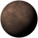
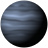
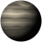

<a href="https://haashirkhan.com"><picture><source media="(prefers-color-scheme: dark)" srcset="assets/header-dark.svg"><source media="(prefers-color-scheme: light)" srcset="assets/header-light.svg"></picture></a>

<picture><source media="(prefers-color-scheme: dark)" srcset="assets/typing-dark.svg"><source media="(prefers-color-scheme: light)" srcset="assets/typing-light.svg"></picture>

<picture><source media="(prefers-color-scheme: dark)" srcset="assets/orbit-dark.svg"><source media="(prefers-color-scheme: light)" srcset="assets/orbit-light.svg"></picture>

<table>
<tr>
<td width="50%" valign="top">

<b>Now</b> 
AI Solutions Engineer Co-op at <b>Magna International</b>. I build multi-agent RAG platforms on Databricks with LangGraph, and the CI/CD, containers and cloud infrastructure that keep them running.
  
Based in Toronto. Studied computer science at the University of Toronto.

</td>
<td width="50%" valign="top">

<b>Mission log</b> 
<b>AI Solutions Engineer Co-op</b> 
Magna International · Aug 2026 to now 
<b>Automation and Systems Analyst Intern</b> 
Perimeter Institute · Aug to Dec 2025 
<b>Software, Cloud and DevOps Intern</b> 
Perimeter Institute · May to Aug 2025

</td>
</tr>
</table>

<picture><source media="(prefers-color-scheme: dark)" srcset="assets/stack-dark.svg"><source media="(prefers-color-scheme: light)" srcset="assets/stack-light.svg"></picture>

<table>
<tr>
<td width="50%" valign="top">

<b>AI and ML</b> 
<code>LLMs</code> <code>RAG</code> <code>Multi-agent systems</code> <code>LangGraph</code> <code>LangChain</code> <code>Databricks Mosaic AI</code> <code>Vector Search</code> <code>PyTorch</code> <code>TensorFlow</code> <code>scikit-learn</code> <code>Computer vision / OCR</code>

</td>
<td width="50%" valign="top">

<b>Cloud and infrastructure</b> 
<code>AWS</code> <code>Azure</code> <code>Databricks</code> <code>Docker</code> <code>Kubernetes</code> <code>Linux</code>

</td>
</tr>
<tr>
<td width="50%" valign="top">

<b>CI/CD and automation</b> 
<code>GitHub Actions</code> <code>Ansible</code> <code>PowerShell</code> <code>Bash</code> <code>Power Automate</code>

</td>
<td width="50%" valign="top">

<b>Languages and data</b> 
<code>Python</code> <code>TypeScript</code> <code>Java</code> <code>Go</code> <code>C</code> <code>PostgreSQL</code> <code>MongoDB</code> <code>FastAPI</code> <code>Next.js</code> <code>React</code> <code>Spring Boot</code>

</td>
</tr>
</table>

<picture><source media="(prefers-color-scheme: dark)" srcset="assets/launched-dark.svg"><source media="(prefers-color-scheme: light)" srcset="assets/launched-light.svg"></picture>

<table>
<tr>
<td width="50%" valign="top">

 <a href="https://github.com/CSC392-CSC492-Building-AI-ML-systems/AutoDocs-Winter2026"><b>AutoDocs</b></a> 2026 
Turns asciinema terminal recordings into structured documentation with a fine-tuned Phi-4 pipeline. Mentored by the Linux Foundation. 
<code>Next.js</code> <code>PostgreSQL</code> <code>PyTorch</code> 
<a href="https://github.com/CSC392-CSC492-Building-AI-ML-systems/AutoDocs-Winter2026">Repo</a> · <a href="https://drive.google.com/file/d/1ssCTLpFQCOF0IWctK1j3NYFi1jjNiI9B/view">Demo video</a>

</td>
<td width="50%" valign="top">

 <a href="https://github.com/ShishirAravindan/nfl-prediction-MoE"><b>NFL Mixture of Experts</b></a> 2024 
Predicts pass or run from pre-snap Big Data Bowl data, with a gating network over CNN, RNN and MLP experts. 
<code>PyTorch</code> <code>pandas</code> 
<a href="https://github.com/ShishirAravindan/nfl-prediction-MoE">Repo</a>

</td>
</tr>
<tr>
<td width="50%" valign="top">

 <a href="https://github.com/gdgutm/PlogGo"><b>PlogGo</b></a> 2025 
Plogging app for web, iOS and Android that spots litter in photos with a server-side detection model. 
<code>React Native</code> <code>Expo</code> <code>Flask</code> <code>MongoDB</code> 
<a href="https://github.com/gdgutm/PlogGo">Repo</a>

</td>
<td width="50%" valign="top">

 <a href="https://github.com/AviGhat/deerhacks2025"><b>Discover Me</b></a> 2025 
DeerHacks IV app that matches travellers to destinations from a personality quiz, with Google Maps and Street View. 
<code>Next.js</code> <code>OpenAI API</code> <code>Google Maps</code> 
<a href="https://github.com/AviGhat/deerhacks2025">Repo</a> · <a href="https://deerhacks2025.vercel.app/">Live site</a>

</td>
</tr>
<tr>
<td width="50%" valign="top">

 <a href="https://github.com/haashirk20/texchange"><b>TexChange</b></a> 2025 
Anonymous text chat roulette. Socket.IO pairs strangers into private rooms and re-queues them on a swap. 
<code>React</code> <code>Express</code> <code>Socket.IO</code> <code>Docker</code> 
<a href="https://github.com/haashirk20/texchange">Repo</a>

</td>
<td width="50%" valign="top">

<b>More</b> 
The full project list and résumé are on my site. 
<a href="https://haashirkhan.com">haashirkhan.com</a>

</td>
</tr>
</table>

<picture><source media="(prefers-color-scheme: dark)" srcset="https://raw.githubusercontent.com/haashirk20/haashirk20/output/telemetry-dark.svg"><source media="(prefers-color-scheme: light)" srcset="https://raw.githubusercontent.com/haashirk20/haashirk20/output/telemetry-light.svg"></picture>

<picture><source media="(prefers-color-scheme: dark)" srcset="assets/activity-dark.svg"><source media="(prefers-color-scheme: light)" srcset="assets/activity-light.svg"></picture> 
<picture><source media="(prefers-color-scheme: dark)" srcset="https://raw.githubusercontent.com/haashirk20/haashirk20/output/snake-dark.svg"><source media="(prefers-color-scheme: light)" srcset="https://raw.githubusercontent.com/haashirk20/haashirk20/output/snake-light.svg"></picture>

<picture><source media="(prefers-color-scheme: dark)" srcset="assets/comms-dark.svg"><source media="(prefers-color-scheme: light)" srcset="assets/comms-light.svg"></picture> 
<a href="https://haashirkhan.com"><picture><source media="(prefers-color-scheme: dark)" srcset="assets/channel-1-dark.svg"><source media="(prefers-color-scheme: light)" srcset="assets/channel-1-light.svg"></picture></a> 
<a href="https://www.linkedin.com/in/haashir-khan/"><picture><source media="(prefers-color-scheme: dark)" srcset="assets/channel-2-dark.svg"><source media="(prefers-color-scheme: light)" srcset="assets/channel-2-light.svg"></picture></a> 
<a href="mailto:haashirk2003@gmail.com"><picture><source media="(prefers-color-scheme: dark)" srcset="assets/channel-3-dark.svg"><source media="(prefers-color-scheme: light)" srcset="assets/channel-3-light.svg"></picture></a>

<picture><source media="(prefers-color-scheme: dark)" srcset="assets/footer-dark.svg"><source media="(prefers-color-scheme: light)" srcset="assets/footer-light.svg"></picture>

